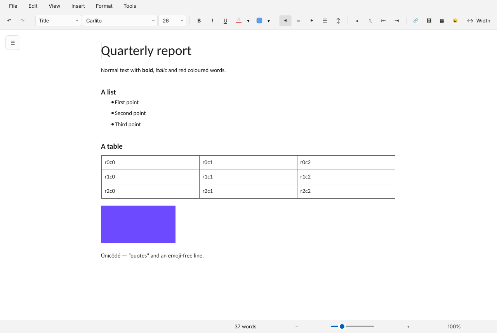
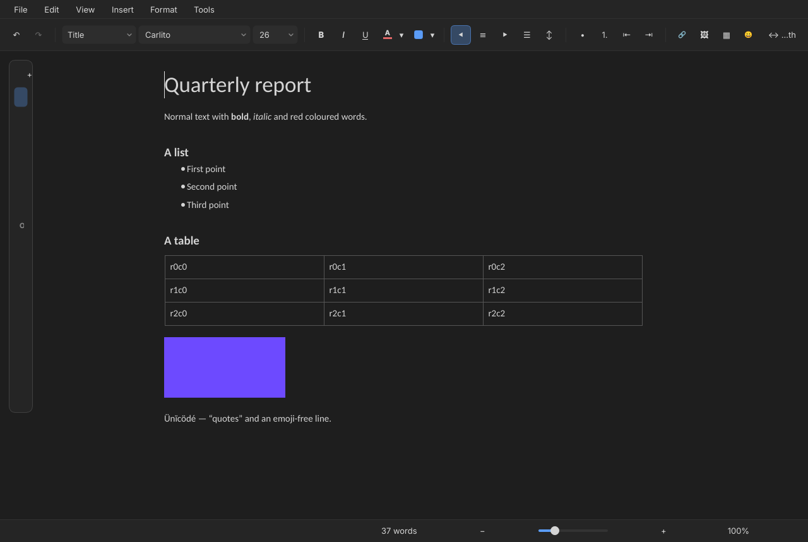
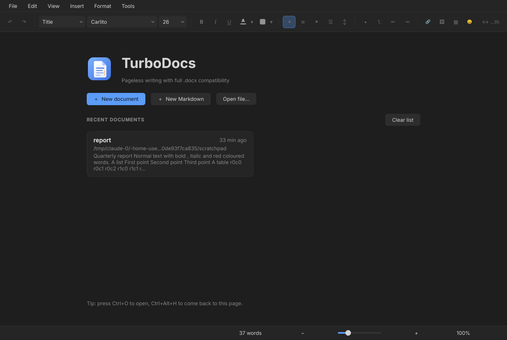
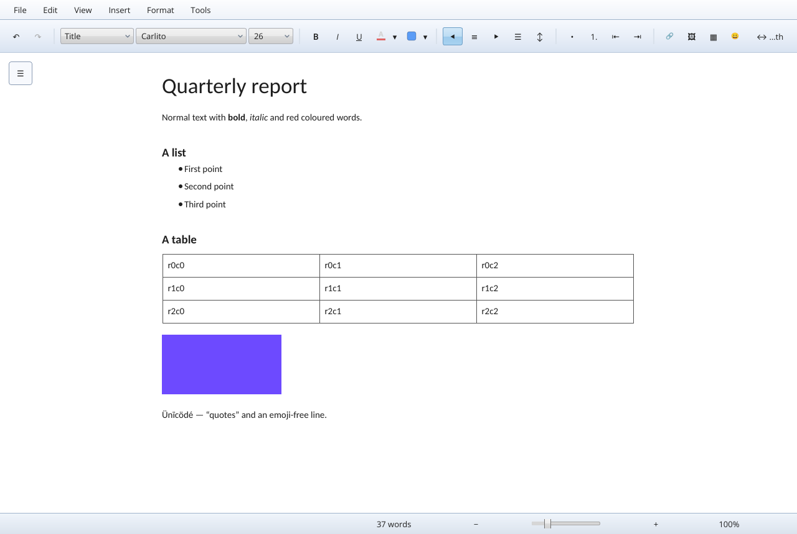
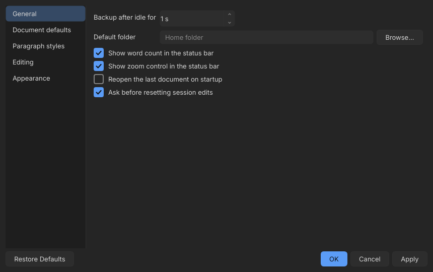

# Reference: the original TurboDocs (Python / Qt)

The editor in the new app copies the **intent and layout** of the first TurboDocs, which lives on the branch `legacy/python`. These screenshots were taken by running that branch headless (`reference/legacy-python/capture.py`, PySide6 with `QT_QPA_PLATFORM=offscreen`, a generated 37-word `.docx`), so they are the real thing, not mock-ups. Check them before changing the editor's layout.

| | |
|---|---|
|  |  |
| Editor in the default look (dark). | The same window in a light look: only colours and widget shapes change. |
|  |  |
| The floating document-tabs panel (open). Closed, it is the ☰ button at the top left of the canvas. | The landing page. |
|  |  |
| A skeuomorphic style: layout identical. | Preferences: a list of sections on the left, OK / Cancel / Apply. |

Menus: [File](reference/legacy-python/menu-file.png), [Format](reference/legacy-python/menu-format.png), [Insert](reference/legacy-python/menu-insert.png).

## The layout, top to bottom
1. **Menu bar:** File, Edit, View, Insert, Format, Tools.
   - File: Home, New, New Markdown, Open, Open recent, Save, Save as, Reset session edits, Preferences, Quit.
   - Edit: Undo, Redo, Cut, Copy, Paste, Paste as plain text, Select all, Find, Replace.
   - View: Markdown view, Document tabs, Text width and margins, Zoom in / out / reset, Full screen.
   - Insert: Image, Table, Link, Emoji, Date.
   - Format: Text (bold, italic, underline, strike, text and highlight colour, size up/down, clear formatting), Paragraph styles (with "Update … to match selection", reset, "save as my defaults"), Align and indent, Line and paragraph spacing, Bulleted list, Numbered list, Page colour, Image (crop, reset size, original size), Table (rows, columns, merge, split, cell colour, delete).
   - Tools: Word count, Preferences.
2. **One formatting toolbar**, in this order: Undo, Redo | paragraph style | font family | size | **B** *I* <u>U</u> | text colour | highlight colour | align left, centre, right, justify | line and paragraph spacing | bullets, numbers, outdent, indent | link, image, table, emoji | *(flexible space)* | **Width** button.
   - Paragraph style choices: Normal text, Title, Subtitle, Heading 1, Heading 2, Heading 3, Bulleted list, Numbered list.
   - The two colour controls are Docs-style **split buttons**: the icon applies the last colour used, the small arrow opens the picker.
   - The size box is editable (presets 8 to 72).
3. **The canvas is pageless**: the text sits directly on the theme's background, no white sheet, in a centred column (default 760 px). The Width button (Ctrl+Alt+W) sets the column width and the left and right margins. Zoom is 25 to 400 %.
4. **A floating ☰ button at the top left of the canvas** opens the **document tabs** panel: tabs inside one document with an outline. They are stored as bookmarks so the file stays an ordinary Word document.
5. **Status bar:** word count (it counts the selection when there is one), then zoom: − slider + percentage.
6. **Dashboard:** logo and name, the tagline "Pageless writing with full .docx compatibility", buttons **New document** (accent), **New Markdown**, **Open file…**, then "Recent documents" as cards (title, how long ago, folder, the first words), a Clear list button, and a tip line ("Ctrl+O to open, Ctrl+Alt+H to come back to this page").
7. **Preferences:** General, Document defaults, Paragraph styles, Editing, Appearance.

## Intent (what it was for)
- Write like in Google Docs, but on a `.docx` that Word opens unchanged: **full compatibility, nothing lost silently**.
- Pageless and calm: the document, a toolbar, nothing else. Every colour comes from the theme; the document follows the theme unless a page colour is set.
- Predictable shortcuts, Google-Docs style: Ctrl+Shift+L/E/R/J align, Ctrl+[ / ] indent, Ctrl+Alt+0 to 3 styles, Ctrl+Shift+7 / 8 lists, Ctrl+K link, Ctrl+\ clear formatting, Ctrl+F / H find and replace, Ctrl+Shift+C word count.
- **Never lose work**: unsaved edits are backed up 1.5 s after the last keystroke and offered back after a crash.
- Markdown is a separate rendering: Ctrl+S in Markdown view saves a `.md` and never touches the `.docx`; a Markdown document can also be started from scratch.
- Images and tables stay editable: click an image to select it, drag a corner to resize, double-click to crop (non-destructive, saved as real docx crops); drag table column borders, right-click for row and column operations, merge and split cells, cell colour.

## Paragraph style defaults (from `styles.py`)
| Style | Size | Weight / style | Colour | Space before / after (px) | Line |
|---|---|---|---|---|---|
| Normal | document default (11 pt) | | | 0 / 6 | 1.18 |
| Title | 28 pt | bold | | 0 / 8 | 1.18 |
| Subtitle | 15 pt | italic | #808080 | 0 / 8 | 1.18 |
| Heading 1 | 22 pt | bold | | 18 / 8 | 1.18 |
| Heading 2 | 17 pt | bold | | 14 / 8 | 1.18 |
| Heading 3 | 14 pt | bold | | 10 / 8 | 1.18 |

Word's Heading 4 to 6 map to Heading 3. Defaults from `prefs.py`: column 760 px, margins 0, document font Carlito (metric-compatible with Calibri), 11 pt, zoom 100 %, backups after 1500 ms.

## Where the new editor stands against it
Checked against the screenshots above by running the real app (Electron under Xvfb) and comparing.

| Legacy feature | New app |
|---|---|
| Pageless canvas on the theme background, centred column | done (`.docx`); default width 760 px |
| Toolbar in the same order, split colour buttons, editable size | done, one row at 1280 px. No strikethrough or emoji button (the legacy toolbar had no strikethrough; emoji is not built) |
| Paragraph styles with the table's values | done: Normal, Title, Subtitle, Heading 1 to 3 (+ bulleted and numbered list buttons) |
| Status bar: word count (selection-aware), zoom slider | done; Ctrl + wheel zooms too |
| Dashboard with New / New Markdown / Open / recent cards | partly: Home has New document, New Markdown, Open a file and the apps; no recent-documents cards |
| Width popup (width, margins) | width only (480 to 1200 px); no margins |
| Menu bar (File, Edit, View, Insert, Format, Tools) | not yet: Save, Save as and "Original view" are buttons on the document header; table operations are in the Table menu |
| Find and replace, word count dialog, emoji, date, Paste as plain text | not yet |
| Document tabs panel (☰) and outline | not yet |
| Images: insert; click to select, drag to resize, crop | insert only (size kept in the file); no resize handles, no crop |
| Tables: insert, rows and columns, merge and split, cell colour, drag column borders | done (column borders are draggable); merged cells survive a save |
| Crash backups after 1.5 s idle | not yet; instead the original file is copied to the app's backups folder before every overwrite |
| Markdown separate from the docx | `.md` and `.txt` are edited as plain text and saved exactly (line endings kept); `.md` has a live preview. No rich Markdown editing |
| Preferences dialog (document defaults, editing options) | Settings page: appearance, apps, guides, this app; no document defaults |
| Per-document paragraph styles ("update to match selection") | not yet |
| Google-Docs shortcuts | those TipTap provides: Ctrl+B/I/U/Z, Ctrl+Shift+L/E/R/J (align), Ctrl+Shift+7/8 (lists). Ctrl+K, Ctrl+\, Ctrl+Alt+0-3, Ctrl+F/H are not bound |
